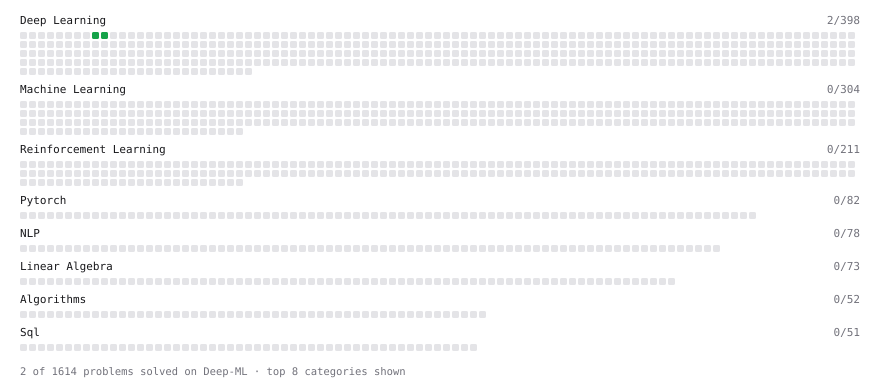

# Deep-ML

My machine learning practice from [Deep-ML](https://www.deep-ml.com). Every solution here was written by hand.

**4** solved · 3 problems · 0 labs · 1 math

[**Browse the interactive portfolio**](https://anshs123.github.io/deep-ml/) to replay this filling in over time.

## Problems

| | Difficulty | Solved | |
| --- | --- | --- | --- |
| [Implement ReLU Activation Function](https://www.deep-ml.com/problems/42) | easy | 2026-10-20 | [solution](problems/0042-implement-relu-activation-function) |
| [Implement the Hard Sigmoid Activation Function](https://www.deep-ml.com/problems/96) | easy | 2026-10-20 | [solution](problems/0096-implement-the-hard-sigmoid-activation-function) |
| [Leaky ReLU Activation Function](https://www.deep-ml.com/problems/44) | easy | 2026-10-20 | [solution](problems/0044-leaky-relu-activation-function) |

## Math

| | Difficulty | Solved | |
| --- | --- | --- | --- |
| [Perceptron Convergence Bound](https://www.deep-ml.com/math-problems/129) | medium | 2026-10-20 | [solution](math/0129-perceptron-convergence-bound) |

---

_This file is regenerated by Deep-ML on every push._
